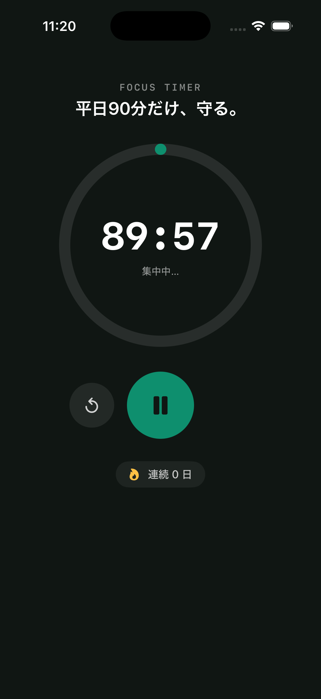
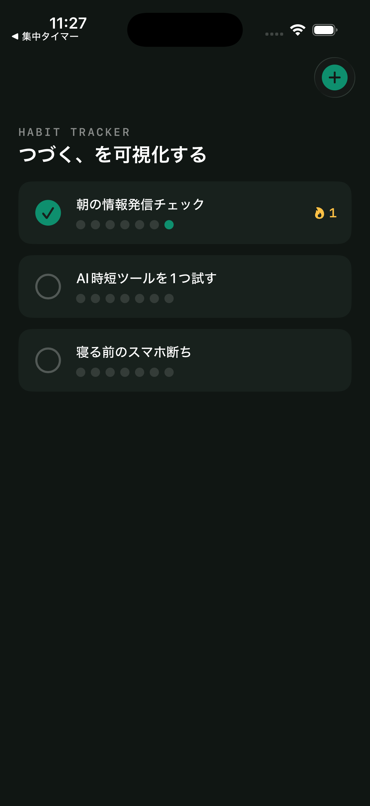
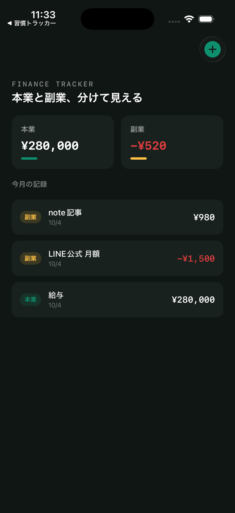

# FTC iPhone Apps

SwiftUI で作った自作 iPhone アプリ3本です。デザインからコードまで一人で制作しました。

| FocusTimer | HabitTracker | FinanceTracker |
|:---:|:---:|:---:|
|  |  |  |
| 集中タイマー | 習慣トラッカー | 家計簿 |

## アプリ

### FocusTimer — 平日90分だけ、守る。
平日に90分だけ集中するためのタイマーです。

- 90分のカウントダウン（円形の進み具合表示）
- スタート／一時停止／リセット
- 90分を達成した日を記録し、連続日数を表示

### HabitTracker — つづく、を可視化する
続けたい習慣を毎日チェックするアプリです。

- 習慣の追加・削除
- タップで今日の達成をチェック
- 直近7日間の記録をドットで表示
- 連続日数を表示

### FinanceTracker — 本業と副業、分けて見える
収入・支出を「本業」「副業」に分けて記録する家計簿です。

- 収入／支出、本業／副業を選んで記録（金額・メモ）
- 今月の合計を本業・副業ごとに自動計算
- スワイプで記録を削除

## 使用技術

- Swift / SwiftUI（iOS 17 以降）
- `ObservableObject` による状態管理
- `UserDefaults` と `Codable` によるデータ保存（データは端末内のみ。ログイン・通信なし）
- 外部ライブラリなし

## 動かし方

1. Mac に Xcode をインストールする
2. このリポジトリをダウンロード（またはクローン）する
3. 動かしたいアプリのフォルダにある `.xcodeproj` を開く
   （例: `FocusTimer/FocusTimer.xcodeproj`）
4. シミュレーターを選んで実行（⌘R）

実機で動かす場合は、Xcode の「Signing & Capabilities」でご自身の Apple ID（チーム）を選んでください。

## フォルダ構成

```
FocusTimer/       集中タイマー
HabitTracker/     習慣トラッカー
FinanceTracker/   家計簿
  ├─ <アプリ名>.xcodeproj   Xcode プロジェクト
  ├─ <アプリ名>/            ソースコード
  └─ screenshots/          スクリーンショット
```

## アプリ制作のご依頼

このようなシンプルな iPhone アプリの制作や、SwiftUI の修正・相談をココナラでお受けしています。
